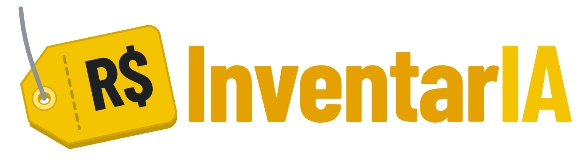
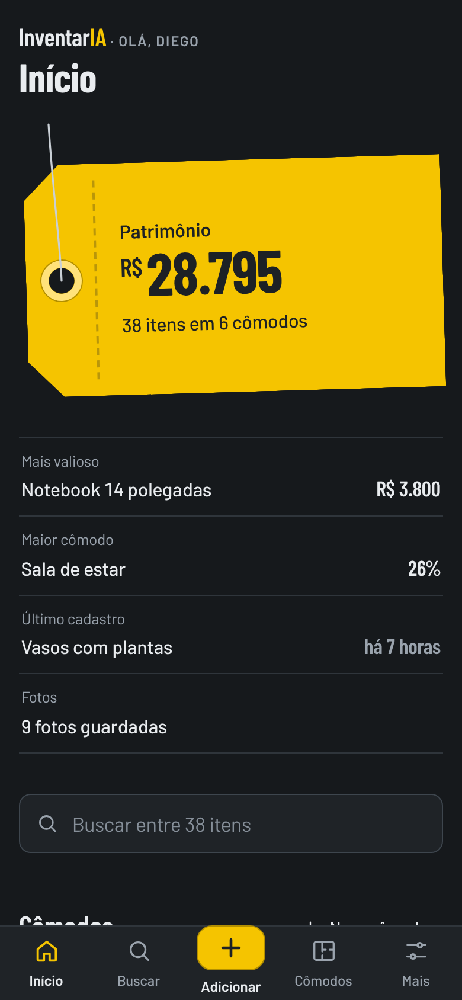
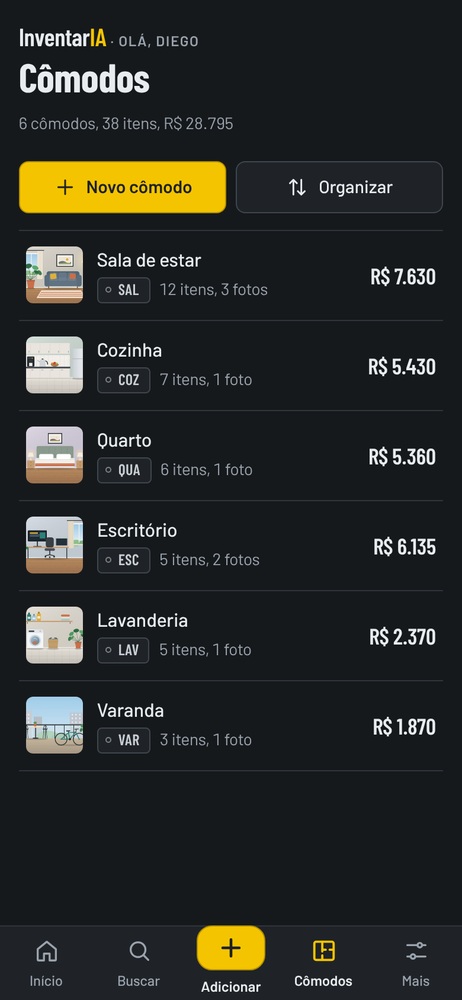
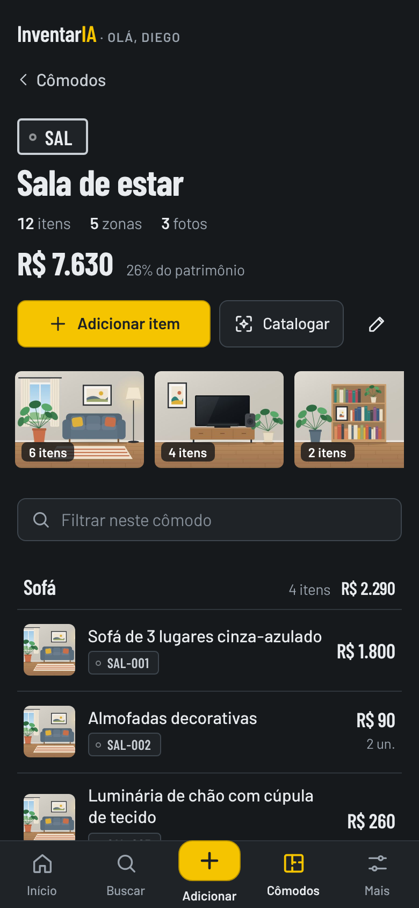
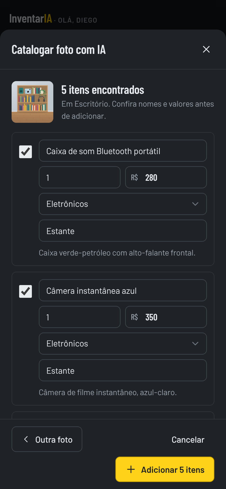

# InventarIA para Home Assistant



Um App do Home Assistant para fazer o **inventário da casa**: cômodos, itens, **fotos e valores**, com **relatório para seguro** e **leitura de fotos por IA**, pela integração de IA que você já usa no Home Assistant.

<p align="center">
  
  
  
  
</p>

[](https://my.home-assistant.io/redirect/supervisor_add_addon_repository/?repository_url=https%3A%2F%2Fgithub.com%2Fdiegozapella63%2Finventario-ha)

## Instalação

1. Toque no botão acima. Se preferir, no Home Assistant abra **Configurações → Aplicativos → Loja de aplicativos**, toque no menu **⋮ → Repositórios** e cole:
   ```
   https://github.com/diegozapella63/inventario-ha
   ```
2. Procure **InventarIA** na loja, toque em **Instalar** e depois em **Iniciar**.
3. Ative **Mostrar na barra lateral**.
4. Abra o InventarIA e importe o seu backup (`.zip`) ou comece do zero.

A primeira instalação leva alguns minutos, porque o app é montado no próprio Home Assistant. Depois, as atualizações aparecem sozinhas, com o botão **Atualizar**.

## O que tem

- **Início** com a etiqueta do patrimônio, o item mais valioso, o maior cômodo, os últimos cadastros e a parte de cada cômodo e de cada categoria no total.
- **Cômodos** com foto, número de itens e valor. Dentro de cada um, os itens ficam agrupados por zona (sofá, estante, bancada), com o subtotal de cada zona. Em **Organizar**, as setas mudam a ordem.
- **Cadastro de itens** com várias fotos (câmera, galeria, arrastar ou colar), quantidade e valor de mercado de usados.
- **Leitura de fotos por IA**: a IA preenche um item a partir da foto, ou lista tudo o que aparece numa foto de prateleira, e você confere antes de salvar. Funciona com Anthropic Claude, OpenAI, Google Gemini ou um modelo local no Ollama, pela ação `ai_task.generate_data` do Home Assistant.
- **Buscar** por nome, marca, detalhe ou zona, sem se importar com acentos, com filtros por cômodo e categoria.
- **Relatório para seguro** por cômodo, com fotos, pronto para imprimir ou salvar em PDF.
- **Exportar** em CSV, JSON ou ZIP com fotos, **backup** na pasta `share/inventario` e versões automáticas a cada 10 minutos de uso.
- **Importar backup** pelo celular, inclusive dividido em partes.
- **Tema claro e escuro** e **cor do app**: amarelo, laranja, coral, rosa, lilás, azul, turquesa, verde, kraft ou cinza.

Mais detalhes em [inventario/DOCS.md](inventario/DOCS.md).

## Seus dados

Os itens e as fotos ficam só no seu Home Assistant, em arquivos abertos (JSON e JPG), e entram nos backups do Home Assistant. Este repositório tem apenas o código do app. As imagens acima são de uma casa de exemplo, com ilustrações no lugar das fotos.

## Estrutura

```
repository.yaml               repositório de apps
inventario/                   o app (config, Dockerfile, ícone, documentação)
inventario/app/server.py      servidor (só biblioteca padrão do Python)
inventario/app/web/           interface (HTML, CSS e JavaScript, sem etapa de build)
docs/                         imagens deste README
```

## Desenvolvimento

```bash
cd inventario/app
INV_DEV=1 INV_DATA=./.data INV_SEED=../seed INV_WEB=./web INV_SHARE=./.share INV_MEDIA=./.media \
  python3 server.py                                  # abre em http://127.0.0.1:8099
```

O app começa vazio: importe um backup `.zip` pela tela de boas-vindas ou crie o primeiro cômodo. Fora do Home Assistant, `INV_AI_MOCK=1` simula a leitura por IA.

## Créditos

Fontes [Barlow](https://fonts.google.com/specimen/Barlow) e [Barlow Condensed](https://fonts.google.com/specimen/Barlow+Condensed) (SIL Open Font License). Ícones e ilustrações feitos para o app.
