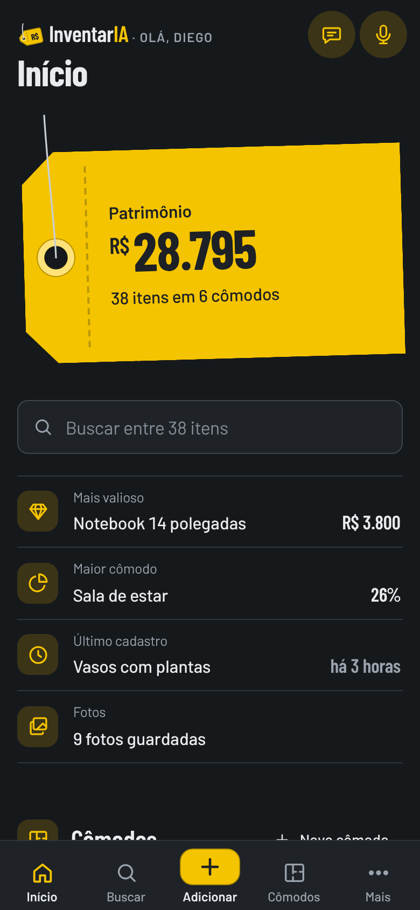
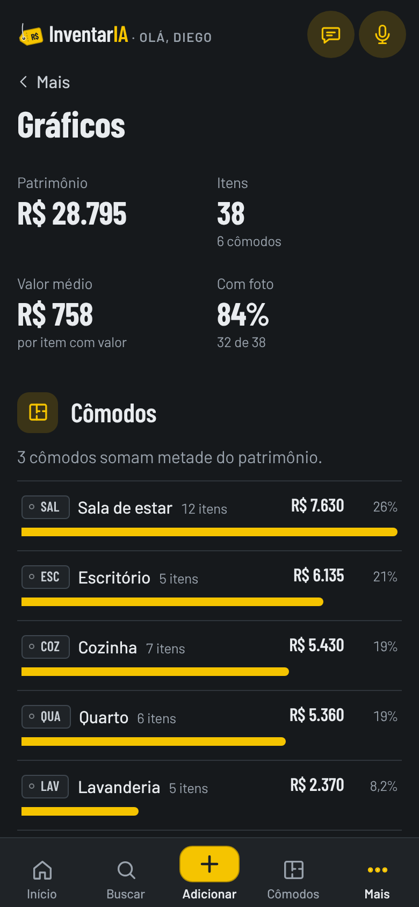
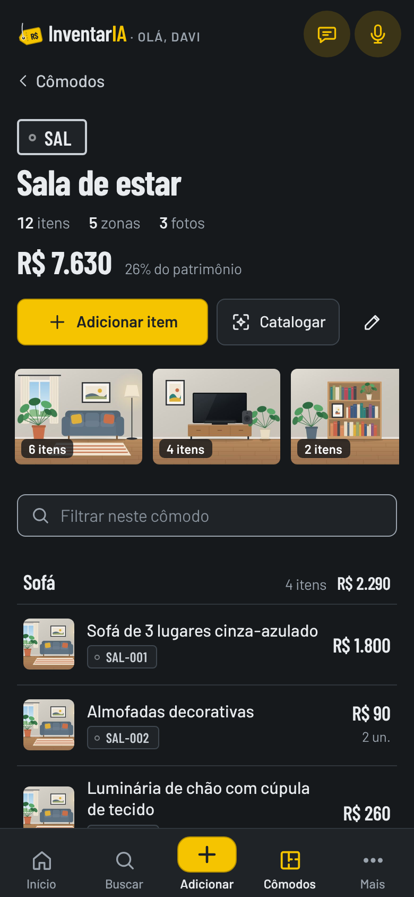
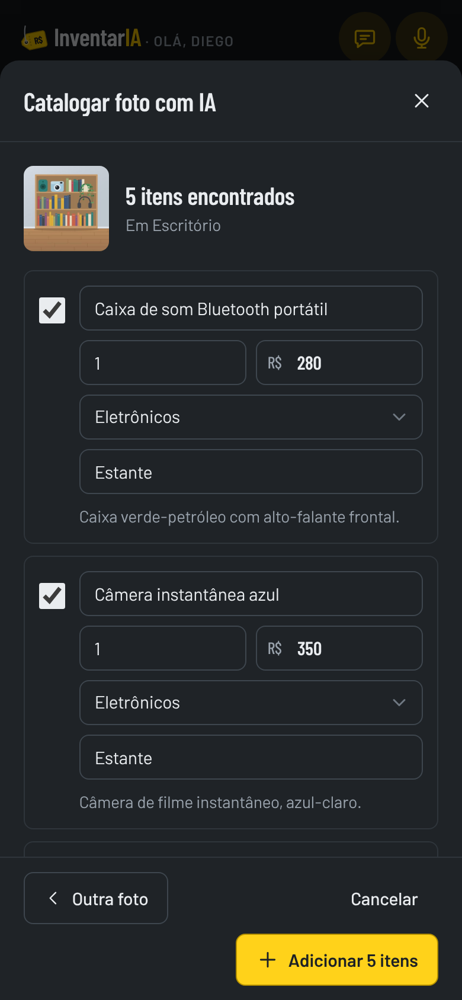

# InventarIA para Home Assistant


Um App do Home Assistant para fazer o **inventário da casa**: cômodos, itens, **fotos e valores**, com **relatório em PDF** e **leitura de fotos por IA**, pela integração de IA que você já usa no Home Assistant.

<p align="center">
  
  
  
  
</p>

[](https://my.home-assistant.io/redirect/supervisor_add_addon_repository/?repository_url=https%3A%2F%2Fgithub.com%2Fdiegozapella63%2Finventario-ha)

## Instalação

1. Toque no botão acima. Se preferir, no Home Assistant abra **Configurações → Aplicativos → Loja de aplicativos**, toque no menu **⋮ → Repositórios** e cole:
   ```
   https://github.com/diegozapella63/inventario-ha
   ```
2. Procure **InventarIA** na loja, toque em **Instalar** e depois em **Iniciar**.
3. Ative **Mostrar na barra lateral**.
4. Abra o InventarIA e importe o seu backup (`.zip`) ou comece do zero.

A primeira instalação leva alguns minutos, porque o app é montado no próprio Home Assistant. Depois, as atualizações aparecem sozinhas, com o botão **Atualizar**.

## O que tem

- **Início** com a etiqueta do patrimônio, a busca, o item mais valioso, o maior cômodo, os últimos cadastros e a parte de cada cômodo no total.
- **Cômodos** com foto, número de itens e valor. Em **Organizar**, as setas mudam a ordem. Cada foto do cômodo mostra os itens que estão nela. Se quiser, ligue as **zonas** para separar os itens de cada cômodo (sofá, estante, bancada), com o subtotal de cada uma.
- **Cadastro de itens** com várias fotos (câmera, galeria, arrastar ou colar), quantidade e valor, e **categorias** que você renomeia, cria ou exclui. Na ficha do item, **Duplicar**, **Mover** e **Excluir**, com Desfazer.
- **Leitura de fotos por IA**: a IA preenche um item a partir da foto, ou lista tudo o que aparece numa foto de prateleira, e você confere antes de salvar. Funciona com Anthropic Claude, OpenAI, Google Gemini ou um modelo local no Ollama, pela ação `ai_task.generate_data` do Home Assistant. Quem não quiser IA desliga numa chave e os botões somem.
- **Falar**: o microfone no alto da tela. Fale os itens e quanto valem; o Home Assistant transcreve com a fala para texto que você escolher (ou a do Assist) e a IA separa os itens para você conferir.
- **Uso da IA**: chamadas de hoje, da semana e do mês, gráfico por dia, últimas chamadas com tokens estimados e, se você ligar, o sensor `sensor.inventaria_ia_hoje` no Home Assistant.
- **Fotos da internet**: num item sem foto, a IA procura o produto no fabricante e nas lojas e o app mostra as fotos para você escolher. A foto fica marcada como ilustrativa, com o site de onde veio. Na mesma busca, a IA traz nome, detalhes, categoria e valor para preencher o item.
- **Novidades** de cada item ou de todos os eletrônicos de uma vez (a IA escolhe quais): atualizações, lançamentos, modelo novo, recalls e fim de suporte, com a fonte de cada um. Pode conferir sozinho toda semana, a cada 15 dias ou todo mês e avisar no celular quando achar algo novo.
- **Conversar** com a IA a qualquer momento, ao lado do microfone, sobre o que está na tela ou qualquer outro assunto.
- **Buscar** por nome, marca ou detalhe, sem se importar com acentos, com filtros por cômodo e categoria, e **Selecionar** para alterar o cômodo, a categoria e a zona de vários itens de uma vez.
- **Bens** fora de casa (casa, terreno, carro), separados em Imóveis, Veículos e Outros: contam no patrimônio e vêm à parte no relatório.
- **Relatório do inventário** por cômodo, com fotos e gráficos, para baixar em PDF.
- **Gráficos**: os cômodos, as categorias e os itens que mais valem, as faixas de valor e o patrimônio mês a mês.
- **Exportar** em CSV, JSON ou ZIP com fotos, **backup** na pasta `share/inventario` e versões automáticas a cada 10 minutos de uso.
- **Importar backup** pelo celular, inclusive dividido em partes.
- **Nos outros apps da casa**: o [ResolvIA](https://github.com/diegozapella63/resolvia-ha) liga tarefas a cômodos e itens daqui (e o [CronologIA](https://github.com/diegozapella63/cronologia-ha) mostra nas tarefas), e o [GerencIA](https://github.com/diegozapella63/gerencia-ha) soma os itens no patrimônio, como bens. Eles só leem: nada muda aqui.
- **Pelo WhatsApp, pelo Claude e pelo Gemini**, com o [CorrerIA](https://github.com/diegozapella63/correria-ha) (se você ligar): ver o resumo, buscar, cadastrar, editar, mover e apagar itens, com as mesmas regras da tela.
- **Celular e computador**: no celular, arrastar para o lado troca de aba; no computador, barra lateral com os cômodos e atalhos de teclado.
- **Tema claro e escuro** e **cor do app**: amarelo, laranja, coral, rosa, lilás, azul, turquesa, verde, kraft ou cinza, ou a **Cor do dia**, que muda todo dia.
- **Sobre** (no fim do menu Mais): quem faz o app e os outros apps da família, cada um com o link para o GitHub.

Mais detalhes em [inventario/DOCS.md](inventario/DOCS.md).

## Seus dados

Os itens e as fotos ficam só no seu Home Assistant, em arquivos abertos (JSON e JPG), e entram nos backups do Home Assistant. Este repositório tem apenas o código do app. As imagens acima são de uma casa de exemplo, com ilustrações no lugar das fotos.

## Estrutura

```
repository.yaml               repositório de apps
inventario/                   o app (config, Dockerfile, ícone, documentação)
inventario/app/server.py      servidor (só biblioteca padrão do Python)
inventario/app/web/           interface (HTML, CSS e JavaScript, sem etapa de build)
tests/                        testes unitários, de integração e visuais, com uma casa inventada
dev/run.sh                    o app no computador, com a casa de teste
preview/, tools/              prévia numa página só, imagens do README e ícone
docs/                         imagens deste README
```

## Desenvolvimento

```bash
dev/run.sh                    # abre em http://127.0.0.1:8099, com a casa de teste e a IA simulada
dev/run.sh --vazio            # como numa instalação nova
tests/run.sh                  # testes unitários e de integração (só Python)
tests/e2e/run.sh              # testes visuais (Playwright)
```

Os testes rodam a cada mudança, na aba **Actions**. Como trabalhar no projeto (checklist de cada mudança, versão, testes e como os apps conversam): [AGENTS.md](AGENTS.md).

## Créditos

Fontes [Barlow](https://fonts.google.com/specimen/Barlow) e [Barlow Condensed](https://fonts.google.com/specimen/Barlow+Condensed) (SIL Open Font License). Ícones e ilustrações feitos para o app.
